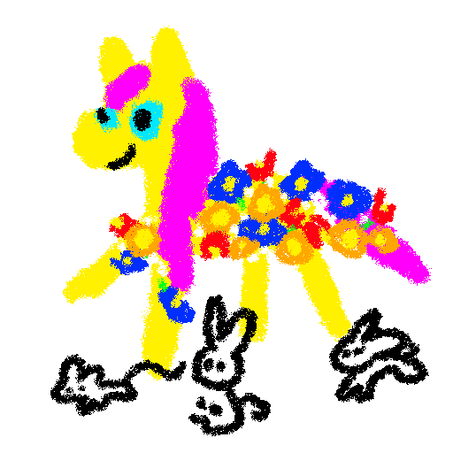
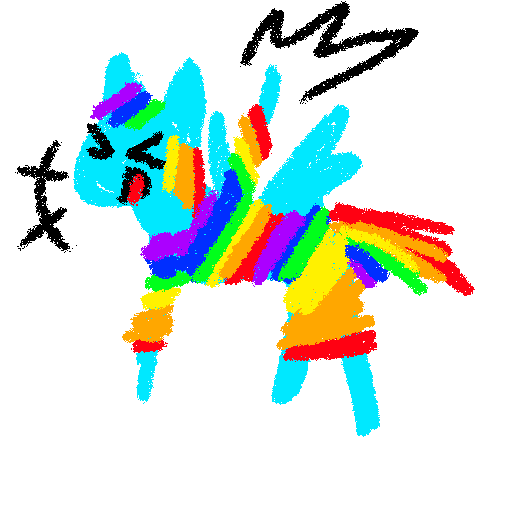
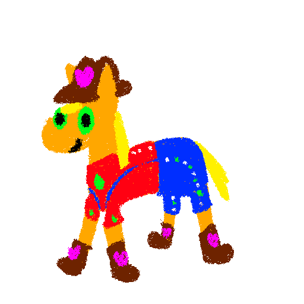
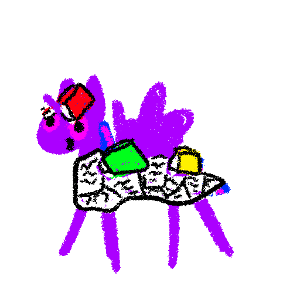
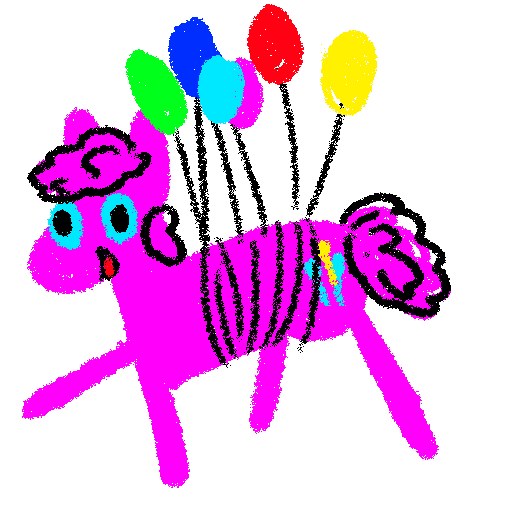
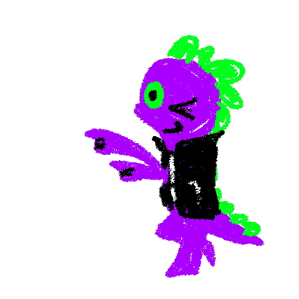
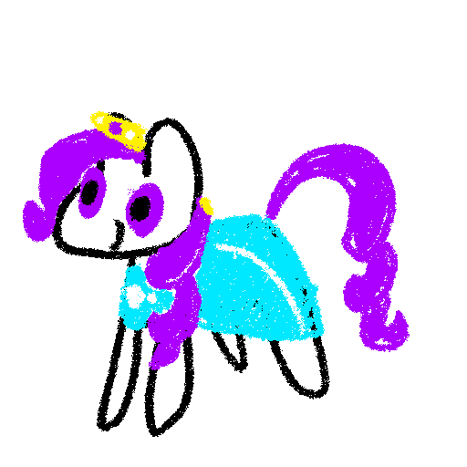

# Rarity’s Super Spectacular Show!

**Rarity’s Super Spectacular Show!**

**by Hoofpaint**

**Once upon a time Rarity said “I’m going to put on a big fashion show!” and everypony was excited because Rarity has the most beautiful dresses. She got all her friends together and made beautiful dresses for everypony. All her friends were super happy to help her friend and put on a fun show.**

“Oh my,” Fluttershy cooed, “Rarity, come look at this one. I think you have a little admirer.”

Rarity looked up from the — frankly, rather dull — submission she was reading. Upon seeing the hoofwritten booklet stapled together, her eyes lit up. “Aww, how delightful! Let’s take a look here.” She scooched next to Fluttershy and began to read along.

**For Fluttershy Rarity made a flowing dress of flowers and it was super majestic. The crowd “oo-d” when Fluttershy walked down the runway and it was like she was a Whinny Princess with all her animal friends joining her too and making her just so much more beautiful. Angel was there too of course! The sweet bunny was super cute.**

“Oh, how… lovely,” Rarity said. Sure, the drawing was cute. It was very clearly made by a filly and drawn in crayon. It was great! It was adorable. It was… 

Very tacky. Just a walking bouquet? Did the filly think Rarity ran a flower shop? Or was she supposed to rob a Horsey Lobby of their entire stock of faux flowers? Not to mention, how would she even tie them together? Perhaps she would weave the stems? Would that be comfortable to wear? Maybe they’re meant to be stitched into some fabric underneath? 

What flowers was she even supposed to use? She may not be an expert on the language of flowers, but even she knew that mixing together unrelated flowers willy-nilly without understanding the meaning behind them would only invite disdain from ponies who knew how to read the *meaning* written into that decision. No, it simply would not do to make the dress without researching the subject beforehoof.

And even then… a dress made of only flowers.

How tacky.

“Isn’t the drawing just the sweetest thing?” Fluttershy cooed. “We have a real artist on our hooves here.”

Rarity hummed. “I wouldn’t go *that* far.” She shook her head. No, this was only a silly story written by a filly. There was no need to analyze every little thing. “It certainly is an inspired design. I’ll say that much.”

**After Fluttershy left the stage** — ‘Runway,’ Rarity thought. — **Rainbow Dash came out next and she was SO dashing! Her dress was inspired by old pegasus robes but all rainbow because Rainbow Dash is the most pegasus pegasus to have ever lived. She was so cool and the crowd was struck when she did flying tricks wearing just the coolest dress. The colors were super impressive and shiny.**

“What does it even mean for colors to be shiny!?” Rarity said. “And is that supposed to be a *toga*? A toga in this day and age? Good heavens, no no no. Especially not one in all rainbow. At the very least, accentuate the—”

“Rarity, it’s not that big of a deal.”

“Not that big of a deal? Fluttershy darling, the design is just *dreadful.* I…” Rarity paused. “Yes, I do suppose you are right. I am taking this far too seriously. Do forgive me. Let’s continue.”

**Next Applejack went on stage and she wore some super down-to-earth work duds made up stylish using the gems Rarity was known for putting in her dresses. She put in emeralds to match Applejack’s eyes and some diamonds since that’s Rarity’s signature. And, most important of all, she put in some cute heart-shaped accents! It was both very beautiful and practical. The crowd whispered about how smart of a dressmaker Rarity was to make something like it.**

“Oh sweet heavens, what is this supposed to be? I swear, if I didn’t know better, I would say Hoofpaint was inspired by the designs you all came up with for your Grand Galloping Gala dresses. She… she wasn’t inspired by those dresses… right?”

Fluttershy shrugged. “Does it matter if she was inspired by them?”

“Of course it does! I can’t have my reputation as a designer be tarnished by those wretched dresses. Especially not now with my new boutiques opening up. I’d be ruined, Fluttershy, ruined! Tell me, is she a local schoolfilly? Or has news of my disaster spread…”

Rarity stopped in her tracks, a dread weight settling on her shoulders. “The Friendship Journal,” she hissed. “No, no, no, you know how cutthroat the fashion industry is. I’ll be the laughingstock backstage of every runway across Equestria by the end of the year!”

“Rarity, calm down.”

“Calm down?! How can you expect me to calm down when—”

Fluttershy draped her wing over Rarity’s back, pulling her in close. “Don’t worry. It’ll be okay. It’ll be all okay. Nopony remembers what those old dresses looked like, and even if they did, they know you made better ones afterwards.”

“But will they really care? You know how the industry can be. One slipup, and you become a has-been. All they’ll care about is that I made *those* dresses too and—”

“This has long since stopped being about the story, hasn’t it?”

“Yes, well, the story is a part of it too. I mean, look at this.” Rarity flipped to the following page.

“These designs are all dreadful!” Rarity fell into hysterics. “And what if ponies come to associate me with designs like this and then start to look into my past and find out about those dresses, and everything I’ve built up falls into RUIN!” 

“I, for one, think that anypony who dismisses your work for a silly reason like that isn’t worth worrying about,” Fluttershy said. “I mean, you’re famous enough to inspire a filly to write a book about you running a fashion show. How many designers can say that?”

“I… that’s true.”

“Not to mention, any pony judging you for those clearly isn’t worth worrying about if they have to dig for *those* to critique you.”

Rarity relaxed. “You’re right. That would be quite a desperate play.”

“Especially since you made such lovely designs in the first place.”

“It makes for quite a story, doesn’t it? You’re right. I could easily turn that around, couldn’t I? I’m sorry. For both worrying you and for overreacting to the book. I guess I’ve just been so stressed lately.”

“You have been working nonstop lately, with the new boutiques and everything. I don’t blame you.”

“Yes, well, I still shouldn’t have reacted the way I had. That was not very becoming of me. Hoofpaint doesn’t deserve it. Not after how much work she’s put into this story. Let’s finish it, shall we?”

**Next Pinkie Pie took the stage… or so everypony expected she would. Instead, she floated over the crowd, suspended by a dozen colorful balloons. She threw candy to the ponies below and made everypony very happy. Surprise! Pinkie Pie wasn’t modeling today. She was there to spread candy and cheer.**

“I could see Pinkie doing that,” Rarity muttered.

“Pinkie would absolutely do that.”

**The crowd gasped at seeing the surprise next model. Twilight’s Number One Assistant Spike! He came out wearing a super cool black jacket that doubled his coolness factor. The sharpness of the jacked perfectly enhanced the spikiness of his scales and fit him perfectly. Everypony was super excited to see such a handsome design worn by a cool dude like him.**

“I could actually see that working on Spike,” Rarity said. “Though it would probably end up adorable more than anything else.”

“Oh, for sure.”

**Finally, the star of the show herself appeared! The crowd lost their breath seeing Rarity in her simple, yet tasteful light blue dress with diamond accents. She also wore a matching gold tiara with amethyst and diamond set in it in order to match her mane, coat, and eyes. The outfit was simple, which was on purpose to help her friends stand out. But it was a very tasteful simple that looked super cute and elegant.**

**The crowd was wowed and everypony stepped back on stage. They gave a bow and the show ended with everypony cheering. It was the best fashion show ever!**

“Oh, I admit it. That was very cute,” Rarity said. “Thanks, by the way. I think I really needed that.”

“Of course! What are friends for?”
