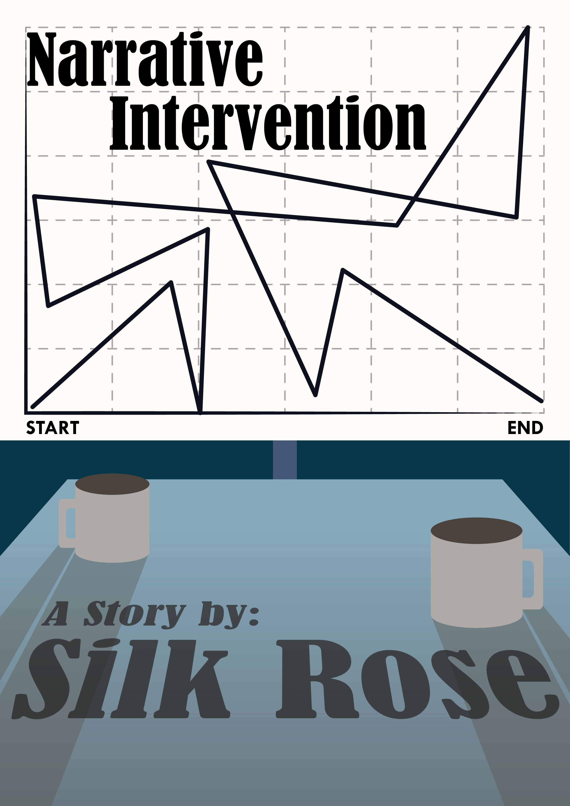

# Narrative Intervention

Rainbow gave Twilight another book. "Look, this one has a custom cover."

Twilight took the book in her hooves and examined the cover.

"Narrative Intervention by Silk Rose."

Pinkie chimed in, "Hey, I know that name, they wrote me a [letter](https://www.fimfiction.net/story/580171/a-letter-of-little-to-no-significance) once!"

Twilight opened the book and read it aloud to the group…

> Twilight and her friends are all gathered inside her treehouse, for some reason.
>
> "Okay girls, you remember why we're here?" Twilight asks, without catching fire.
>
> Her friends nod, amazed by her skill at not spontaneously combusting.
>
> Twilight sighs. "That's why we're here, Mr. Narrator. You need to stop lying in our stories."
>
> I, the narrator, don't reply.
>
> Pinkie Pie speaks down, "He lied about the size of my last party!"
>
> Rainbow Dash becomes a real horse and whinnies.
>
> Fluttershy says something, but you can only read it if you donate five dollars.

Twilight sighed. "One of *those* stories."

Pinkie shrugged. "I like it so far."

> Rarity groans. "Can you at least talk to us?"
>
> Applejack does a cartwheel. "Come on, just talk with us."
>
> I finally decide to speak. "Maybe."
>
> Twilight asks, "Do you have a name we should call you?"
>
> I simply answer, "Twilight Sparkle, but you can call me Twilight for short."
>
> Twilight groans. Which one? I don't know.

Twilight groans.

> Fluttershy tries to pay Twilight the five dollars from earlier, but the Ko-Fi link had to be removed to not break the rules.
>
> Rarity asks, "Did you just change to third pony perspective from first?"
>
> Twilight doesn't reply, but Twilight does. "I don't know," I say.
>
> Applejack asks, "Can we have a normal conversation? We're just trying to talk here."
>
> I, the real Twilight Sparkle, say, "Why don't you like my changes? I'm just doing my job."
>
> Pinkie protests the current destruction of this story. "You're supposed to narrate the story how it happens, not lie and change facts."
>
> Unfortunately, she was looking at the wrong Twilight while saying it.

Rarity pondered, "Do you think they had an idea for what they were writing when they started, or did they just start writing and making up stuff as they went?"

Twilight laughed. "Definitely the second thing."

> Twilight backs her up, "Yeah, why are you doing this?"
>
> I frown. "I'm not the one doing this, really."
>
> Rarity realizes a realization of real life. "Wait, Twilight's right! The author is the one making them do all this stuff."
>
> Everypony gasps at this revelation.
>
> Silk Rose pauses this story to remind you that Pinkie is in fact best pony!

Pinkie cheered, "Yay!"

> Rainbow Dash, unable to speak, blinks in Morse code. "-.-. .- -. / -.-- --- ..- / - ..- .-. -. / -- . / -... .- -.-. -.- / .. -. - --- / .- / .--. --- -. -.-- ..--.."

Twilight said, "She asked to be turned back into a pony, in all capitol letters, mind you."

> Twilight obliges and turns Rainbow Dash back into a pony.
>
> Fluttershy hugs Rainbow Dash. "I missed you!"
>
> Rainbow Dash blinks. ".. / -- .. ... ... . -.. / -.-- --- ..- / - --- --- .-.-.-"

Twilight explained again, "She said she missed you too, Fluttershy."

> Fluttershy did not see the blinks as they were not done hugging at the time.
>
> Pinkie Pie asks, "So, um, Silk Rose, why are you making the narrator change the stories we are in?"
>
>Silk Rose replied, "Because I wanted to write this story to send in to the New Golden Oak Library."

Pinkie commented, "It has been interesting seeing ponies write stories about the new library."

Twilight nodded.

> Twilight, the narrator one, asks, "So, this is all just a bit for a story?"
>
> Silk Rose replied, "Yes. None of those previous changes before this meeting ever actually happened. I just wrote them in to give examples."
>
> A darkness spreads across pony Twilight's face. "Well, how many words are left in this story?"
>
> Rarity replies, "(Insert correct answer here.)"

Twilight chucked, "Looks like they forgot something…"

> Pinkie gasps. "What's going to happen for the rest of the story then?"
>
> Silk Rose thought for a moment, then said, "Thorax, you decide."
>
> Unfortunately, Thorax's section had to be cut due to budgetary constraints.

Pinkie said, "Hey, a new character!"

> Rainbow Dash finally speaks normally, asking, "What does that even mean?"

Rainbow agreed with herself. "Yea, what does that even mean, they are the one who wrote this story!"

> Silk Rose shrugged. "You girls like romance?"
>
>Rarity smiles and nods. "Of course, darling."

Rarity commented, "At least they are getting characteristics about us right."

> Silk Rose asked, "Do you have a crush on anypony?"
>
> Rarity thinks for a second as a blush forms on her face. "I might have a crush on Pinkie Pie."

Pinkie gasped, "Is that true, Rarity?"

Rarity answered, "No, sorry darling," before giving Rainbow a sidelong glance.

> Pinkie gasps. "Wait, if Silk Rose is the one writing this story, and they asked you the question, doesn't that mean they would just make you have a crush on whoever they wanted?"
>
> Twilight (Which one?) answers, "Probably, but don't you have a crush on Rarity too?"
>
> Pinkie blushes. "Umm, yes."
>
> Pinkie bounces over to Rarity. "Rarity, will you go out with me?"
>
> Rarity answers with delight in her eyes, "Yes!"
>
> The two ponies hug as everypony else d'awws in response.

Twilight said, "that was a quick romance."

> Fluttershy's other world counterpart from Canterlot High shows up and takes a selfie with Fluttershy and then they hug.

Twilight questioned, "How does this author know about that world and school?"

Everypony shurgged.

> After all the hugging was over, Fluttershy files her taxes.

Fluttershy said, "Oh, that's a good reminder, I need to do that soon."

> Pinkie asks an innocent question, "What happens to us when the story ends?"
>
> Silk Rose told her the harsh truth. "You will each get a free puppy."

Fluttershy smiled. "I like puppies."

> Everypony smiles as they think of what to name their puppy.
>
> They settle on the names of: Sprinkles, Sprinkles, Sprinkles, Sprinkles, Sprinkles, Twilight Sprinkles, and Narrator Sprinkles.

Twilight said, "I think Sprinkles is a fine name, but I would probably name my puppy Orion."

Pinkie said, "I would name my puppy Sprinkles, yes."

Applejack said, "I would name mine Sandy."

Rarity said, "I would name them after a gemstone like Opal."

Fluttershy said, "I would name them Chip."

Rainbow said, "I would name him Buddy."

> Silk Rose didn't know what to do next so they asked Smolder.
>
> Smolder says, "Talk about your favourite scrap metal."

Twilight said, "Why would they put this in the story, does this pony know how a story works?"

> Rarity spoke first. "I really like platinum. It's great for jewelry and accents on dresses."
>
> Rainbow Dash says, "Gold, because I'm always in first place!"
>
> Pony Twilight says, "I like copper because it's so versatile and useful."
>
> Fluttershy says, "I love uranium, it's great for making nuclear bombs."

Everypony looked at Fluttershy. 👀

She just hid behind her mane.

> Pinkie Pie says, "I love stainless steel, it's great for bakeware and in a pinch you can use it as a mirror."
>
> Applejack says, "I like lead because it tastes good."
>
> Smolder un-pauses this story to remind you that Fluttershy and Sweetie Belle are in fact best pony!

Twilight commented, "Maybe now the story can go somewhere…"

> Silk Rose forgot what they were doing and asks Aloe what to do.
>
> Aloe says, "They should compare tails!"
>
> All six ponies turn their butts towards each other to form a circle. They each try to move their tail so it's in view, but struggle with how cramped it is.
>
> While struggling, their tails get interwoven into a knot.
>
> Each pony starts to struggle to get loose, but all fail.
>
> Rarity starts to panic, worried for her tail's health.

Rarity stated, "Valid."

> Fluttershy's tail extensions break loose and she is fried. (freed?)

Fluttershy said sadly, "I don't have tail extensions…"

> Pinkie giggles and starts playing tug of war.
>
> Twilight sighs in defeat and gives up.
>
> Applejack does a cartwheel.
>
> Rainbow Dash Rainbow Dashes.
>
> Twilight casts a spell, freeing them all.

Twilight said, "At least it didn't turn into a queen rat… or queen pony in this case."

> Sea Swirl comes by and flips the story upside down.

Applejack asked, "How do you turn a story upside down?"

Rainbow added, "Does that mean it'll get good now?"

Everypony laughed.

Twilight had to flip the book one hundred and eighty degrees to read the next section.

> ˙dn ǝpᴉs ʇɥƃᴉɹ ʎɹoʇs ǝɥʇ pǝddᴉlɟ ǝɹɐɯ ʎlǝuol ɯopuɐɹ ∀
>
> ˙ɹoolɟ ǝɥʇ ʍou sɐʍ ɥɔᴉɥʍ ƃuᴉlᴉǝɔ ǝɥʇ oʇ llǝɟ ʎuodʎɹǝʌƎ

Twilight asked, "Why?"

Pinkie shrugged.

> Everypony falls back onto the floor.
>
> Twilight groans. "Okay, I'm done. This story is over," she says before catching on fire.
>
> The end.

Twilight said, "Well, that was something…"

Pinkie nodded as she pet her new puppy Sprinkles. "I liked it!"

"Pinkie, where did you get that puppy?"

"From Silk Rose."

Twilight looked around, noticing all her friends had new puppies, including herself.

She just shrugged and pet her puppy.
